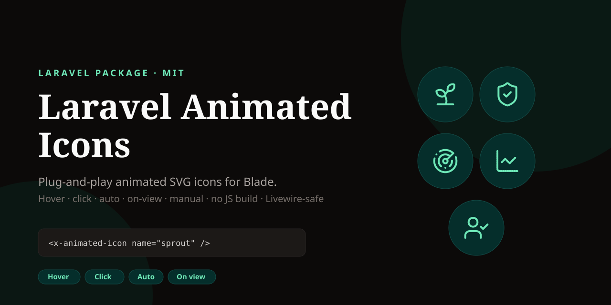

<p align="center">
    
</p>

<h1 align="center">Laravel Animated Icons</h1>

<p align="center">
    <a href="https://github.com/aotr/laravel-animated-icons/actions/workflows/tests.yml">
        
    </a>
    <a href="https://packagist.org/packages/aotr/laravel-animated-icons">
        
    </a>
    <a href="https://packagist.org/packages/aotr/laravel-animated-icons">
        
    </a>
    <a href="LICENSE">
        
    </a>
    
    
</p>

<p align="center">
    <strong>Plug-and-play animated SVG icons for Laravel Blade.</strong><br>
    Hover, click, auto, on-view and manual triggers. One component, one manifest, no JS build step.
</p>

<p align="center">
    <a href="https://aotr.github.io/laravel-animated-icons/"><strong>Live demo →</strong></a>
    ·
    <a href="#installation">Installation</a>
    ·
    <a href="#triggers">Triggers</a>
    ·
    <a href="#adding-icons">Adding icons</a>
    ·
    <a href="#manual-api">Manual API</a>
</p>

---

## Why

- **Zero build step.** The runtime is served by the package. No Vite entry, no npm dependency.
- **Five triggers.** Hover, click, auto, on-view and manual — per icon.
- **Livewire-safe.** One delegated listener; conditional icons and validation errors animate without re-init.
- **Any parent triggers it.** Hover a button, link or `[data-animated-icon-trigger]` and all icons inside move.
- **Accessible by default.** Decorative SVG, `prefers-reduced-motion`, and an inert JSON manifest.
- **Registry sync.** `php artisan animateicons:sync bell-ring` converts the AnimateIcons source into keyframes.
- **Live editing.** In local, the first use of an unknown icon installs it automatically.
- **Ten starter icons included.** `sprout`, `shield-check`, `radar`, `chart-line`, `user-check`, `handshake`,
  `chevron-down`, `circle-question-mark`, `arrow-right`, `user-round`.

## Requirements

- PHP 8.2+
- Laravel 11, 12 or 13

## Installation

```bash
composer require aotr/laravel-animated-icons
```

For the latest unreleased changes, install from GitHub:

```json
"repositories": [
    { "type": "vcs", "url": "https://github.com/aotr/laravel-animated-icons" }
]
```

```bash
composer require aotr/laravel-animated-icons:^1.0
```

Publish the config (optional — the starter set works without it):

```bash
php artisan vendor:publish --tag=animated-icons-config
```

Add the runtime once per layout, after the content:

```blade
<body>
    {{ $slot }}

    <x-animated-icons-assets />
</body>
```

That is the whole setup. The package serves both the runtime and its stylesheet —
no JS build, no asset publishing, no extra CSS.

## Quick start

```blade
<x-animated-icon name="sprout" class="h-5 w-5" />
```

`class` lands on the `<svg>`, so Tailwind size and color utilities work as usual.

```blade
{{-- a button triggers every icon inside it --}}
<button type="button" class="...">
    <x-animated-icon name="shield-check" class="h-5 w-5" />
    Connect broker
</button>
```

## Triggers

| Trigger | When it plays | Example |
|---|---|---|
| `hover` (default) | Pointer or keyboard focus on the icon / its button, link or trigger | `<x-animated-icon name="sprout" />` |
| `click` | Click on the icon or its trigger | `<x-animated-icon name="shield-check" trigger="click" />` |
| `auto` | Once when it appears on screen (state changes included) | `<x-animated-icon name="radar" trigger="auto" />` |
| `visible` | Once when scrolled into view | `<x-animated-icon name="chart-line" trigger="visible" />` |
| `none` | Only through the manual API | `<x-animated-icon name="handshake" trigger="none" />` |

Any `button`, `a` or element with `data-animated-icon-trigger` drives the icons inside it:

```blade
<article data-animated-icon-trigger class="group ...">
    <x-animated-icon name="technical" class="h-6 w-6" />
    Technical Analysis
</article>
```

Speed can be tuned per icon:

```blade
<x-animated-icon name="chevron-down" speed="fast" />
<x-animated-icon name="hammer" speed="slow" />
```

## Manual API

```js
window.AnimateIcons.play(document.querySelector('[data-animated-icon="shield-check"]'));

// every icon on the page
window.AnimateIcons.playAll();

// an event, e.g. after a broker callback or a Livewire action
document.dispatchEvent(new CustomEvent('animated-icon:play', {
    detail: { name: 'handshake' },
}));

// or a selector
document.dispatchEvent(new CustomEvent('animated-icon:play', {
    detail: { selector: '.js-broker-status' },
}));
```

## Adding icons

```bash
php artisan animateicons:sync heart
php artisan animateicons:sync bell-ring wifi map-pin --dry-run
```

The command fetches the icon from the [AnimateIcons](https://animateicons.in) registry, converts its Motion
variants into Web Animations keyframes, and writes it to `animated-icons.generated_path`
(default: `config/animated-icons-generated.php`).

- **Local auto-install:** using an unknown icon fetches it on first render and writes the generated file.
- **Production:** no fetch while rendering. Run `animateicons:sync` before deploying.
- **Never touches hand-authored icons.** Add those to `animated-icons.icons` in the config.

### Hand-authored icons

```php
'icons' => [
    'my-glyph' => [
        'markup' => '<g data-part="root"><path d="..."/></g>',
        'animation' => [
            'root' => [
                'keyframes' => [
                    ['transform' => 'scale(1)'],
                    ['offset' => 0.5, 'transform' => 'scale(1.08)'],
                    ['transform' => 'scale(1)'],
                ],
                'duration' => 450,
                'easing' => 'ease-in-out',
            ],
        ],
    ],
],
```

A part maps to `data-part="..."` in the markup. A part can have one track or a list of tracks
(for per-property timings — the sync command uses this automatically).

## Configuration

```php
return [
    'icons' => [/* name => markup + animation */],
    'generated_path' => config_path('animated-icons-generated.php'),
    'auto_install' => null, // null = local only; true/false = force
];
```

`auto_install` can also be set with `ANIMATED_ICONS_AUTO_INSTALL`; the generated path with
`ANIMATED_ICONS_PATH`.

## Livewire & Alpine

The runtime is delegated on `document`, so icons inserted by Livewire (validation errors, OTP state,
loading states) animate without `wire:` wiring or re-initialisation.

```blade
@if ($otpSent)
    <x-animated-icon name="lock-check" trigger="auto" class="h-5 w-5" />
@endif
```

## CSP

The manifest is an inert `<script type="application/json">`; the runtime is a same-origin file.
If you use a strict CSP, pass a nonce:

```blade
<x-animated-icons-assets :nonce="csp_nonce()" />
```

## Testing

```bash
composer test
```

The package tests the registry converter against real AnimateIcons sources. The host application
tests in this repository cover the Blade components, triggers, sync command and asset route.

## Changelog

See [CHANGELOG.md](CHANGELOG.md).

## Contributing

See [CONTRIBUTING.md](CONTRIBUTING.md). Issues and PRs are welcome.

## Security

See [SECURITY.md](SECURITY.md). Please report vulnerabilities privately.

## Credits

- [AnimateIcons](https://animateicons.in) for the animated icon source and registry.
- [Lucide](https://lucide.dev) for the base icon set.
- [Animesh Chakraborty](https://github.com/aotr) for the package.

## License

MIT. See [LICENSE](LICENSE).
